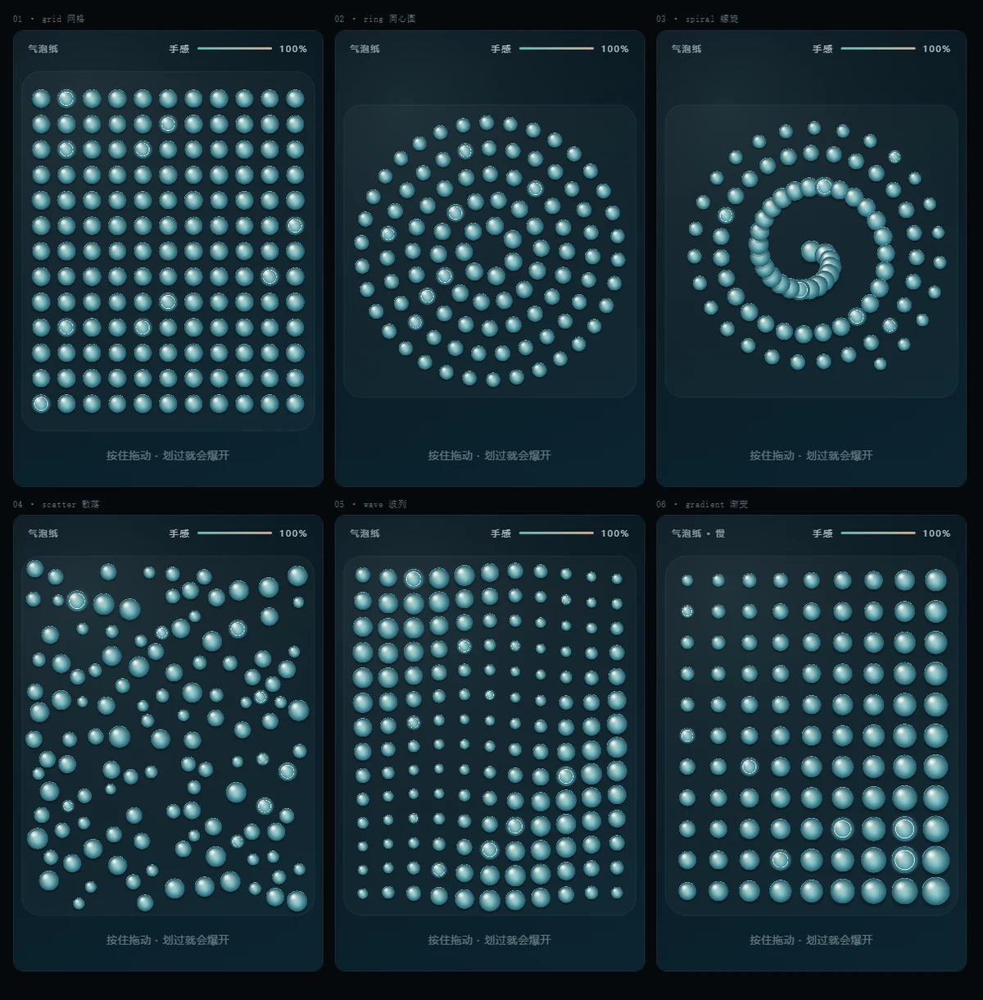
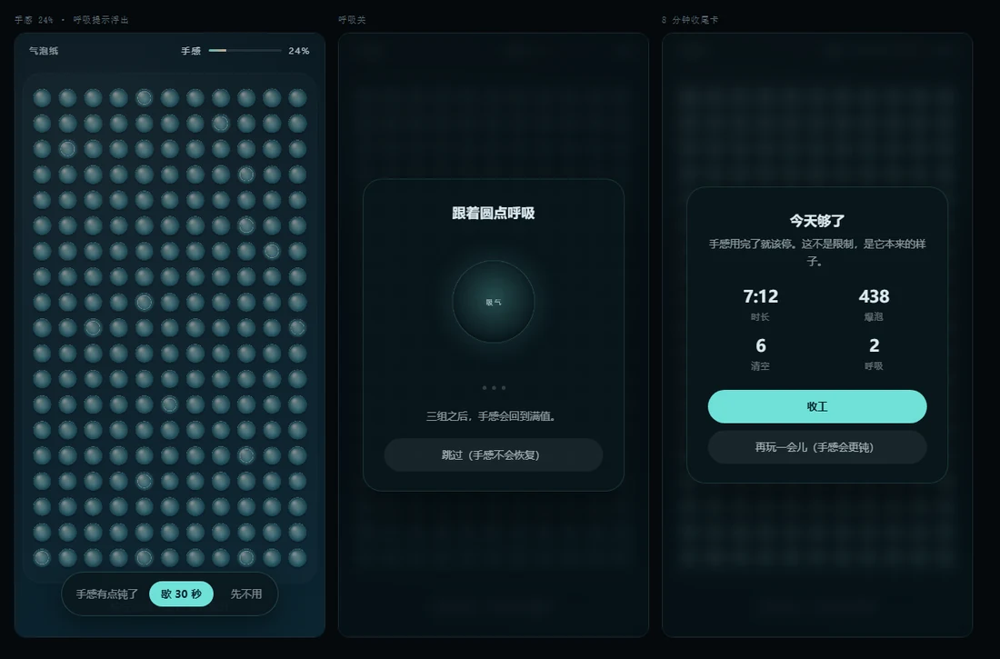
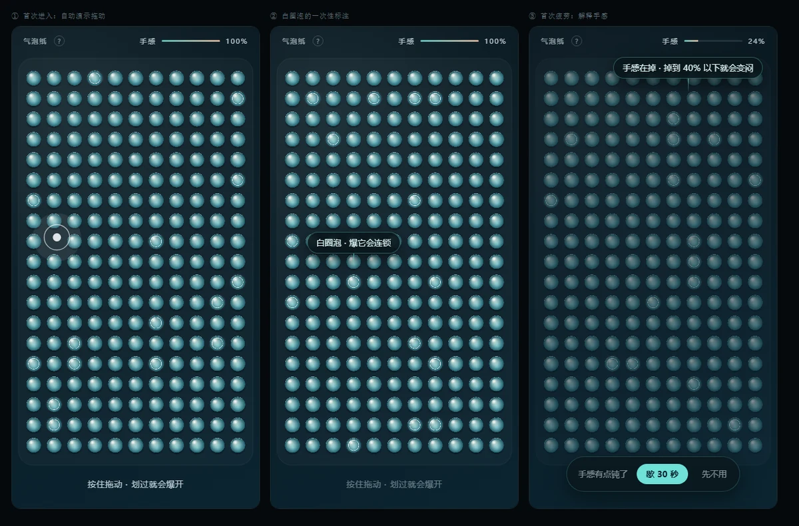

<div align="center">
  
</div>

<h1 align="center">手感 · Handfeel</h1>

<p align="center">
  <b>A stress-relief toy that gets dull the longer you play.</b><br>
  一款玩久了会变闷的解压小游戏。
</p>

<p align="center">
  <a href="https://huan0-gg.github.io/handfeel/"><b>▶ 在线试玩 / Play</b></a>
  &nbsp;·&nbsp;
  <a href="DESIGN.md">设计文档 / Design doc</a>
  &nbsp;·&nbsp;
  <a href="LICENSE">MIT</a>
</p>

---

## 为什么做这个 / Why this exists

大多数"解压"产品优化的是停留时长。签到、抽卡、红点、连续登录——这些机制**制造焦虑**，而产品的唯一职责是消除焦虑。

Most "stress-relief" apps optimize for time-on-app. Streaks, loot boxes, red dots, daily check-ins — mechanics that *create* anxiety in a product whose only job is to reduce it.

手感走的是反方向：**你玩得越久，它越不好玩**。不是弹窗拦你，是声音变闷、颜色变灰、气泡变迟钝——就像真的捏了十分钟气泡纸，手会麻。

Handfeel goes the other way: **the longer you play, the worse it feels.** No pop-up blocks you. The sound dulls, the color drains, the bubbles get sluggish — the way your hands actually go numb after ten minutes of real bubble wrap.



---

## 核心循环 / Core loop

| | |
|---|---|
| **手感下降** | 每爆一颗泡，手感 -0.55。低到 40% 以下，音色低通、视觉降饱和、气泡呼吸变慢 |
| **呼吸关** | 吸 4 秒 / 呼 6 秒 × 3 组，30 秒后手感回满 |
| **可以跳过** | 跳过不恢复手感，也不惩罚——你继续玩闷的，自然后果 |
| **8 分钟收尾** | 出现一次总结卡：收工，或继续（疲劳速度 ×1.6） |

**没有签到，没有抽卡，没有排行榜，没有体力值，没有推送。**

---

## 已实现 / What's in v0.1.0

| | |
|---|---|
| 四步情境引导 | 自动演示拖动 · 白圈泡标注 · 手感解释 · `?` 重看 |
| 六种牌型 | 网格 / 同心圆 / 螺旋 / 散落 / 波列 / 渐变，每张一换 |
| 连锁反应 | 白圈泡会带动周围一圈依次炸开，音高递增 |
| 四种材质 | 波形与衰减各不相同（正弦 / 三角波，0.075–0.19s 衰减） |
| 慢牌 | 每 7 张一次，呼吸频率降到 35% |
| 清场计时 | 只和自己比，破纪录才提示 |
| 纯合成音效 | Web Audio 实时生成，**零音频文件** |



---

## 运行 / Run it

单文件、零依赖、零构建：

```bash
git clone https://github.com/huan0-gg/handfeel.git
cd handfeel
open index.html          # macOS
# start index.html       # Windows
```

或者直接开一个静态服务器：

```bash
python -m http.server 8000
```

需要 **Pointer Events** 和 **Web Audio**。iOS Safari 的音频需要在首次触摸后才解锁（代码里已处理）。

---

## 技术细节 / Notes

- 单文件 `index.html`，Canvas 2D，`devicePixelRatio` 适配
- 气泡是**离屏预渲染的精灵图**（每种材质 × 是否带环 = 8 张），每帧只做 `drawImage`
- 音效全部实时合成：正弦下滑音 + 带通噪声脆响，不加载任何资源
- 状态不写 `localStorage`（只记"引导看过没"，不记进度，避免沉没成本）
- 调试参数：`?demo=grid|ring|spiral|scatter|wave|gradient|tired|breathe|summary|onboard|coach|chain`、`?autotest=1`

---

## 没做的 / Deliberately not built

| | |
|---|---|
| 每日签到 / 连续登录 | 制造损失厌恶，把"想玩"变成"不得不玩" |
| 抽卡 / 随机材质 | 可变比率强化，成瘾性最强，与解压目标直接冲突 |
| 排行榜 / 好友对比 | 把放松场景变成竞争场景 |
| 无限滚动 / 自动下一关 | 消灭自然的停止点 |
| 存档 / 沉没成本 | 断了就断了，不该有"舍不得删"的负担 |
| 体力值 / 付费解锁 | 把防沉迷做成付费墙 |

还有几件**技术上也还没做**的：完美爆点（最大形变帧松手给泛音）、双子泡 / 彩色泡特殊牌面、真机性能调优。

---

## 贡献 / Contributing

这是个人项目，没有正式流程。开个 issue 说说你想改什么，或者直接 PR。设计上的取舍都写在 [DESIGN.md](DESIGN.md) 里，改之前建议先看一眼——尤其是"反模式清单"那节。

---

## License

[MIT](LICENSE) © 2026 顾欢 (huan0-gg)
